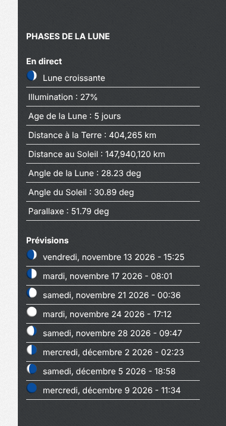
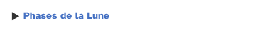

# lunarPhase : guide d'utilisation

lunarPhase ajoute un gadget qui affiche la phase actuelle de la Lune, ses caractéristiques du moment et les dates des prochaines phases.

## Table des matières

1. [Ajouter le gadget](#ajouter-le-gadget)
2. [Les informations affichées](#les-informations-affichées)
3. [Les réglages](#les-réglages)
4. [Bon à savoir](#bon-à-savoir)

## Ajouter le gadget

Allez dans **Gadgets**, ajoutez « Phases de la Lune » à la zone de votre choix (par exemple « Extra »), puis enregistrez.

Sur le blog, le gadget affiche deux parties : « En direct » et « Prévisions ».

## Les informations affichées

La partie **En direct** donne, au moment de l'affichage :

* la phase de la Lune (avec une petite image) ;
* son illumination, en pourcentage ;
* son âge, en jours ;
* sa distance à la Terre et au Soleil, en kilomètres ;
* l'angle de la Lune et du Soleil, et la parallaxe de la Lune, en degrés.

La partie **Prévisions** liste les dates et heures des prochaines phases : nouvelle lune, premier quartier, pleine lune, dernier quartier, etc. L'heure est celle du fuseau horaire du blog. Au survol d'une ligne, le nom de la phase apparaît.

Les petites images sont ajoutées par la feuille de style du plugin, uniquement dans une zone du thème dont l'identifiant est `sidebar`.

## Les réglages

Cliquez sur le nom du gadget pour déplier ses réglages.

* **Titre** : le titre du gadget.
* Une case par information de la partie « En direct » : phase, illumination, âge, distance à la Terre, distance au Soleil, angle de la Lune, angle du Soleil, parallaxe. Décochez celles que vous ne voulez pas.
* **Afficher toutes les prévisions** des prochaines phases de la Lune.
* Les options habituelles des gadgets : page d'accueil seulement, contenu seul, classe CSS, hors ligne.

Si vous décochez toutes les informations « En direct » et les prévisions, seul le titre reste affiché.

## Bon à savoir

* Les angles de la Lune et du Soleil et la parallaxe sont affichés avec une valeur erronée : par exemple « Angle de la Lune : 28.23 deg » et « Parallaxe : 51.79 deg », alors que la taille apparente de la Lune est d'environ 0,5° et sa parallaxe d'environ 1°. Les valeurs, déjà en degrés, sont converties une seconde fois.
* Les distances utilisent une virgule comme séparateur de milliers (« 404,265 km »), même en français.
* La première ligne des prévisions peut être une phase déjà passée.
* Les images des phases ne s'affichent que si la zone du thème s'appelle `sidebar`.
